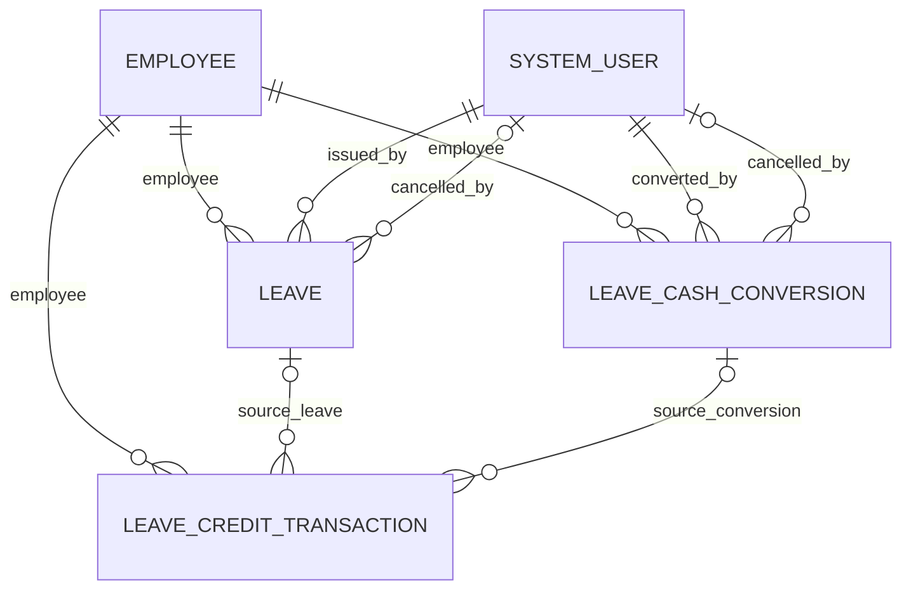

# The Daily Operation — Leave Management Data Model

Schema specification for the Leave Management module, following the structure
of [data-model.md](data-model.md). The owner requirements are in
[PLANS.md](../PLANS.md); naming follows
[naming-conventions.md](naming-conventions.md). The existing
[security model](security-model.md) provides the data-layer security principles;
the Leave-specific privileges below come from PLANS.md.

**Status: Stages 1–3 complete in The Daily Operation - Dev; Stage 3 verified on
2026-10-22.** All three tables, 39 specified columns, nine business relationships,
required choice defaults and both Active composite alternate keys exist in
`A365_DailyOperations`. Three Code App data sources and their typed models and
services are generated. The owner explicitly authorized applying the planned
Payroll Admin grants, overriding the earlier manual-only role instruction.
The grants are applied and verified; environment auditing was left unchanged.

The logical names below were read back from Dataverse and match PLANS.md. Actual
schema names, primary keys, entity sets, navigation properties and choice values
are recorded here and in [live verification evidence](leave-schema-verification.json).
Never derive application bindings from display names.

---

## Scope and current verification

Investigation, creation and metadata read-back performed on **2026-10-21**:

| Item | Evidence / result |
|---|---|
| Existing environment | `The Daily Operation - Dev`; MCP registration targets `https://org9a7651f0.crm5.dynamics.com` |
| Solution unique name | `A365_DailyOperations`, verified through a live MCP query |
| Solution display name | `A365-DailyOperations`; unmanaged |
| Publisher | `Automations365`; customization prefix `a365`; option-value prefix `74991`, verified through the solution's publisher |
| Employee lookup target | `a365_employee`; entity set `a365_employees`; primary key `a365_employeeid`, verified through MCP schema inspection |
| Existing Employee-to-user link | `a365_employee.a365_systemuser` is a lookup to `systemuser` |
| Actor lookup target | `systemuser`; entity set `systemusers`; primary key `systemuserid`, verified through MCP schema inspection |
| Leave table discovery before creation | Inspected 549 custom table definitions, including display names; no Leave, vacation, sick-leave, credit-transaction or cash-conversion candidates were found; no additional metadata page was returned |
| Existing components | Employee, System User, unmanaged solution, publisher and PHP currency were already correct and reused |
| Created components | Three Leave tables, their planned columns/relationships and two composite ledger keys; both indexes verified Active in Stage 2 |
| Incompatible legacy components | None found in the pre-creation inventory; no migrations, remapping or deletions were performed |
| Ownership / primary keys | All three tables are UserOwned; each Dataverse-generated GUID primary key and primary-name column was verified |
| Auditing | New table and specified column flags are enabled; environment-wide auditing was disabled at inspection and was left unchanged |
| Existing data and roles | No employee/payroll record writes or sample Leave records; only the 14 explicitly authorized Payroll Admin grants were added, with unrelated privileges preserved |

The owner confirmed creation in the existing Dev environment. Relationships
were created only after reading their parent tables' actual primary keys. These
links also appear in the existing parent tables' relationship metadata; existing
Employee/User columns and records were not rewritten. No employee or payroll
records were retrieved for this schema work.

The schema task supports admin-issued paid/unpaid leave, a VL/SL credit ledger,
VL cash conversion, cancellation/restoration, and a future unpaid-leave boundary
to Payroll. There is **no approval workflow**. This task does not implement
screens, business operations, notifications, flows, sample records, or payroll
changes. It adds no database, holiday table, or document storage.

---

## Common table settings

These settings apply to all three created tables.

| Setting | Required design |
|---|---|
| Table type | Standard Dataverse table |
| Ownership | User or Team owned (`UserOwned`); verify before creation/reuse |
| Solution | Existing `A365_DailyOperations`; reuse its publisher |
| Primary name | `a365_name`, Text, maximum 200 characters; reuse a suitable existing primary-name column rather than replacing it |
| Primary key and entity set | Verified GUID primary keys and entity sets are listed in each table section and the metadata register |
| Auditing | Enabled and verified on all three tables and 39 specified columns; environment-wide auditing remains disabled, so these flags alone do not produce an audit history |
| Standard audit fields | Keep Dataverse Created By/On and Modified By/On (`createdby`, `createdon`, `modifiedby`, `modifiedon`) |
| Business actor fields | Real lookups to existing `systemuser`, not names, email addresses, or text IDs |
| Business timestamps | Verified Date and Time, UserLocal behavior; use UTC ISO timestamps and actual user lookup bindings, following the Payroll convention |
| Leave calendar dates | Both `DateTimeBehavior = DateOnly` and `Format = DateOnly` |
| Business relationships | Nine verified relationships with Restrict Delete; Assign, Merge, Reparent, Share and Unshare are NoCascade |
| Business statuses | Custom choices, separate from standard `statecode` / `statuscode` |
| Security | Admin-only through manually configured Dataverse privileges; never rely on hidden UI controls |

The existing Payroll service writes actor timestamps as UTC ISO strings and
actor references through case-sensitive `systemuser` navigation bindings; see
[payroll-period-service.ts](../src/features/payroll/services/payroll-period-service.ts).
Reuse the convention, but inspect each new relationship's actual navigation
property before generating or writing bindings.

Date-only display formatting on a timezone-aware timestamp is insufficient for
leave calendar dates. Microsoft distinguishes the behavior from the display
format in [date/time metadata guidance](https://learn.microsoft.com/en-us/power-apps/developer/data-platform/behavior-format-date-time-attribute).

**Required** in the column tables means the intended Dataverse business-required
level (`ApplicationRequired`), except platform-managed fields. Verify required
levels after creation. Future service/server validation must also protect direct
requests; schema metadata and form validation alone are not the full business
rule enforcement mechanism.

---

## `a365_leave` — Leave

- **Status:** Created and verified on 2026-10-21; 16 specified columns; zero records.
- **Display / plural:** Leave / Leaves.
- **Ownership:** User or Team owned.
- **Primary name:** Name (`a365_name`, Text, maximum 200).
- **Schema name:** `a365_Leave`.
- **Entity set:** `a365_leaves`.
- **Primary key:** `a365_leaveid` (Dataverse-generated GUID, verified primary-ID flag).

### Columns

| Display name | Logical name | Type | Required | Notes |
|---|---|---|---|---|
| Name | `a365_name` | Text, max 200 | Yes | Primary name; reuse a compatible existing primary name |
| Employee | `a365_employee` | Lookup → `a365_employee` | Yes | Reuse the existing Employee table; no text ID/name substitute |
| Leave Type | `a365_leavetype` | Choice | Yes | VL, SL, Emergency |
| Benefit | `a365_benefit` | Choice | Yes | Paid, Unpaid |
| Start Date | `a365_startdate` | Date Only | Yes | Date Only behavior and format |
| End Date | `a365_enddate` | Date Only | Yes | Date Only behavior and format |
| Days | `a365_days` | Decimal, precision 2 | Yes | Minimum 0.50; no additional business maximum specified |
| Leave Status | `a365_leavestatus` | Choice | Yes | Issued, Cancelled; default Issued |
| Issued By | `a365_issuedby` | Lookup → `systemuser` | Yes | Admin actor |
| Issued On | `a365_issuedon` | Date and Time | Yes | Preserve original issue timestamp |
| Notification Status | `a365_notificationstatus` | Choice | Yes | Not sent, Sent, Failed; default Not sent |
| Note | `a365_note` | Multiline Text, max 2000 | No | Business note |
| Cancelled By | `a365_cancelledby` | Lookup → `systemuser` | No | Populated by the later cancellation operation |
| Cancelled On | `a365_cancelledon` | Date and Time | No | Cancellation timestamp |
| Cancellation Reason | `a365_cancellationreason` | Multiline Text, max 2000 | No | Preserve cancellation context |
| Notified On | `a365_notifiedon` | Date and Time | No | Timestamp for the latest required notification |

### Status and notification intent

The business statuses are Issued and Cancelled. There is no Pending, For Review,
Approved, or Rejected stage. Cancellation preserves the Leave record and the
original issue audit fields; related credit restoration uses compensating ledger
transactions.

Notification Status represents the latest required **issue or cancellation**
notification. No sending, retry mechanism, delivery history, or provider is
implemented by this schema task. Do not interpret Notified On as proof of a
successful send without the later operation's verified result.

---

## `a365_leavecashconversion` — Leave Cash Conversion

- **Status:** Created and verified on 2026-10-21; 12 specified columns; zero records.
- **Display / plural:** Leave Cash Conversion / Leave Cash Conversions.
- **Ownership:** User or Team owned.
- **Primary name:** Name (`a365_name`, Text, maximum 200).
- **Schema name:** `a365_LeaveCashConversion`.
- **Entity set:** `a365_leavecashconversions`.
- **Primary key:** `a365_leavecashconversionid` (Dataverse-generated GUID, verified primary-ID flag).

### Columns

| Display name | Logical name | Type | Required | Notes |
|---|---|---|---|---|
| Name | `a365_name` | Text, max 200 | Yes | Primary name; reuse a compatible existing primary name |
| Employee | `a365_employee` | Lookup → `a365_employee` | Yes | Existing Employee record |
| Year | `a365_year` | Whole Number | Yes | Calendar year; business year bounds are not specified |
| Days | `a365_days` | Decimal, precision 2 | Yes | Minimum 0.50, maximum 5.00 per record |
| Daily Rate Used | `a365_dailyrateused` | Currency, precision 2 | Yes | Historical daily-rate snapshot |
| Amount | `a365_amount` | Currency, precision 2 | Yes | Historical conversion-amount snapshot |
| Converted By | `a365_convertedby` | Lookup → `systemuser` | Yes | Admin actor |
| Converted On | `a365_convertedon` | Date and Time | Yes | Original conversion timestamp |
| Conversion Status | `a365_conversionstatus` | Choice | Yes | Recorded, Cancelled; default Recorded |
| Cancelled By | `a365_cancelledby` | Lookup → `systemuser` | No | Cancellation actor |
| Cancelled On | `a365_cancelledon` | Date and Time | No | Cancellation timestamp |
| Cancellation Reason | `a365_cancellationreason` | Multiline Text, max 2000 | No | Preserve cancellation context |

### Money and history

VL cash conversion records preserve the **rate used and amount at the time of
conversion**. Neither field is a formula tied to the employee's current salary.
Changing salary later must not recalculate these snapshots.

Use the environment's existing PHP currency configuration. Currency columns
have Dataverse-managed base-value companions and currency/exchange-rate
metadata. PHP was verified as the existing active/base currency with precision
2; the two new money columns have precision 2 and PrecisionSource 0 (column
precision). No currency or organization setting was changed.

The 5.00 maximum is a **per-record column constraint**, not enforcement of an
annual conversion total. No annual cap or daily-rate formula is supplied by
this schema plan. Do not invent a salary divisor or automatically add the amount
to Payroll. Cancellation retains the original snapshot and uses a restoration
transaction in the ledger.

---

## `a365_leavecredittransaction` — Leave Credit Transaction

- **Status:** Created and verified on 2026-10-21; 11 specified columns; zero records.
- **Display / plural:** Leave Credit Transaction / Leave Credit Transactions.
- **Ownership:** User or Team owned.
- **Primary name:** Name (`a365_name`, Text, maximum 200).
- **Schema name:** `a365_LeaveCreditTransaction`.
- **Entity set:** `a365_leavecredittransactions`.
- **Primary key:** `a365_leavecredittransactionid` (Dataverse-generated GUID, verified primary-ID flag).

### Columns

| Display name | Logical name | Type | Required | Notes |
|---|---|---|---|---|
| Name | `a365_name` | Text, max 200 | Yes | Primary name; reuse a compatible existing primary name |
| Employee | `a365_employee` | Lookup → `a365_employee` | Yes | Balance and operation-uniqueness dimension |
| Year | `a365_year` | Whole Number | Yes | Calendar-year balance dimension |
| Credit Pool | `a365_creditpool` | Choice | Yes | VL, SL |
| Transaction Type | `a365_transactiontype` | Choice | Yes | Accrual, Grant, Deduction, Restoration, Cash conversion |
| Days | `a365_days` | Signed Decimal, precision 2 | Yes | Verified bounds -100000000000 to 100000000000; technical storage bounds, not entitlement limits |
| Transaction Key | `a365_transactionkey` | Text, max 150 | Yes | Reused on every retry of the same employee operation |
| Leave | `a365_leave` | Lookup → verified Leave table | No | Link leave deductions/restorations to their source |
| Cash Conversion | `a365_cashconversion` | Lookup → verified Leave Cash Conversion table | No | Link conversion deductions/restorations to their source |
| Period Key | `a365_periodkey` | Text, max 100 | No | Scheduled accrual/grant uniqueness, scoped to Employee |
| Note | `a365_note` | Multiline Text, max 2000 | No | Business/audit context |

### Ledger rules

| Event | Signed Days | Source reference |
|---|---|---|
| Accrual | Positive | Period Key identifies the credit pool and accrual period |
| Grant | Positive | Period Key where the configured operation uses one |
| Paid leave deduction | Negative | Leave lookup |
| Cash conversion | Negative | Cash Conversion lookup; VL pool |
| Restoration | Positive | Original Leave or Cash Conversion lookup |
| Unpaid leave | No credit deduction | Leave remains the business record |

**Balance = SUM(Days), grouped by Employee + Credit Pool + Year.** There is no
stored mutable balance column and no annual reset transaction. Historical ledger
rows remain auditable; corrections append compensating transactions rather than
editing or deleting past credits/debits. Accrual rates, grant entitlements and
scheduling are not specified by this schema task.

The ledger is intended to be append-only for Payroll Admin. Source consistency,
transaction sign, restoration validity, and available-credit checks require
later service/server implementation. A lookup alone does not verify that the
source record belongs to the same employee or year.

### Composite alternate keys

| Key purpose | Columns on the ledger | Actual schema / logical name | Current status |
|---|---|---|---|
| One scheduled credit per employee and period | `a365_employee` + `a365_periodkey` | `a365_EmployeePeriodKey` / `a365_employeeperiodkey` | Active — verified 2026-10-21 |
| One transaction per employee and operation | `a365_employee` + `a365_transactionkey` | `a365_EmployeeTransactionKey` / `a365_employeetransactionkey` | Active — verified 2026-10-21 |

Both key names, participating columns and Active statuses were read back from
Dataverse together in the final Stage 2 snapshot; see
[Stage 2 verification evidence](leave-schema-stage2-verification.json). No
pre-existing keys or ledger records were found before creation. Neither text
column is globally unique by itself. Two employees may use the same
operation/period text; the employee lookup is part of each unique constraint.

Period Key examples from PLANS.md:

```text
VL-2026-11
SL-2026
```

Transaction Key examples from PLANS.md:

```text
ACCRUAL-VL-2026-11
GRANT-SL-2026
LEAVE-<leave-guid>-DEDUCTION
LEAVE-<leave-guid>-RESTORATION
CONVERSION-<conversion-guid>-DEDUCTION
CONVERSION-<conversion-guid>-RESTORATION
```

Angle-bracket tokens are placeholders for actual GUIDs, not literal key values.
Each retry must reuse the original Transaction Key. The **nullable Period Key
does not replace the required Transaction Key**: Dataverse does not enforce
alternate-key uniqueness when a participating column is null. Key creation is
asynchronous; Pending, In Progress, or Failed is not Active.
[Microsoft alternate-key reference](https://learn.microsoft.com/en-us/power-apps/maker/data-platform/define-alternate-keys-reference-records)

Populate Period Key only for the operation it identifies. Reusing an accrual's
Period Key for its compensating transaction would collide with the same
Employee + Period Key; the correction needs its own operation identity under a
later agreed correction policy. Do not delete duplicates to activate an index.

Unique keys prevent duplicate keyed rows. They do **not** guarantee atomic
updates across a Leave/Conversion record and its ledger entries, or prevent two
concurrent operations from spending the same balance.

---

## Lookup relationships

All nine relationships below were created and verified. Their parent primary
keys are `a365_employeeid`, `systemuserid`, `a365_leaveid` or
`a365_leavecashconversionid`, according to the target. The following metadata
register gives the actual case-sensitive binding/navigation names.
System-generated owner/audit/currency relationships are separate from these
business relationships.

| Child table | Lookup | Parent table | Required | Delete |
|---|---|---|---|---|
| Leave | `a365_employee` | Existing `a365_employee` | Yes | Restrict |
| Leave | `a365_issuedby` | Existing `systemuser` | Yes | Restrict |
| Leave | `a365_cancelledby` | Existing `systemuser` | No | Restrict |
| Leave Cash Conversion | `a365_employee` | Existing `a365_employee` | Yes | Restrict |
| Leave Cash Conversion | `a365_convertedby` | Existing `systemuser` | Yes | Restrict |
| Leave Cash Conversion | `a365_cancelledby` | Existing `systemuser` | No | Restrict |
| Leave Credit Transaction | `a365_employee` | Existing `a365_employee` | Yes | Restrict |
| Leave Credit Transaction | `a365_leave` | Verified Leave table | No | Restrict |
| Leave Credit Transaction | `a365_cashconversion` | Verified Leave Cash Conversion table | No | Restrict |

| Relationship schema name | Child table | Actual navigation property |
|---|---|---|
| `a365_employee_leave` | `a365_leave` | `a365_Employee` |
| `a365_systemuser_leave_issuedby` | `a365_leave` | `a365_IssuedBy` |
| `a365_systemuser_leave_cancelledby` | `a365_leave` | `a365_CancelledBy` |
| `a365_employee_leavecashconversion` | `a365_leavecashconversion` | `a365_Employee` |
| `a365_systemuser_leavecashconversion_convertedby` | `a365_leavecashconversion` | `a365_ConvertedBy` |
| `a365_systemuser_leavecashconversion_cancelledby` | `a365_leavecashconversion` | `a365_CancelledBy` |
| `a365_employee_leavecredittransaction` | `a365_leavecredittransaction` | `a365_Employee` |
| `a365_leave_leavecredittransaction` | `a365_leavecredittransaction` | `a365_Leave` |
| `a365_leavecashconversion_leavecredittransaction` | `a365_leavecredittransaction` | `a365_CashConversion` |

For example, the Leave employee binding is `a365_Employee@odata.bind` pointing
to `/a365_employees(<employee-guid>)`. The transaction's Leave binding is
`a365_Leave@odata.bind` pointing to `/a365_leaves(<leave-guid>)`. These examples
use verified navigation names and entity sets, not inferred casing.



The optional source relationships support a single ledger for accruals, grants,
leave deductions, conversions and restorations. Required combinations for each
transaction type belong in later business validation, not guessed extra schema.

---

## Choices and defaults

All seven are **local choices**, created with null option integers so Dataverse
allocated values under publisher prefix `74991`. The exact values below were
read back; no existing choice was modified. The full choice definitions are in
the live verification evidence.

| Table | Column | Labels and verified numeric values | Default | Actual local choice name |
|---|---|---|---|---|
| Leave | `a365_leavetype` | VL = 749910000; SL = 749910001; Emergency = 749910002 | None | `a365_leave_a365_leavetype` |
| Leave | `a365_benefit` | Paid = 749910000; Unpaid = 749910001 | None | `a365_leave_a365_benefit` |
| Leave | `a365_leavestatus` | Issued = 749910000; Cancelled = 749910001 | Issued = 749910000 | `a365_leave_a365_leavestatus` |
| Leave | `a365_notificationstatus` | Not sent = 749910000; Sent = 749910001; Failed = 749910002 | Not sent = 749910000 | `a365_leave_a365_notificationstatus` |
| Leave Cash Conversion | `a365_conversionstatus` | Recorded = 749910000; Cancelled = 749910001 | Recorded = 749910000 | `a365_leavecashconversion_a365_conversionstatus` |
| Leave Credit Transaction | `a365_creditpool` | VL = 749910000; SL = 749910001 | None | `a365_leavecredittransaction_a365_creditpool` |
| Leave Credit Transaction | `a365_transactiontype` | Accrual = 749910000; Grant = 749910001; Deduction = 749910002; Restoration = 749910003; Cash conversion = 749910004 | None | `a365_leavecredittransaction_a365_transactiontype` |

Do not add approval states. If an existing Conversion Status has Pending,
Approved, or Rejected, report its options, record counts and dependencies, then
propose a non-destructive correction. Removing/remapping choices or migrating
records requires a separate owner decision.

---

## Permissions — applied and verified

The owner explicitly requested that these permissions be applied directly.
All listed Payroll Admin grants are **Organization scope**; unlisted privileges
on the three new tables are None. Read-back confirmed the complete matrix for
both named roles after the change.

| Table | A365 - Payroll Admin | A365 - Payroll Employee |
|---|---|---|
| Leave | Create, Read, Write, Append, Append To | No privileges |
| Leave Credit Transaction | Create, Read, Append | No privileges |
| Leave Cash Conversion | Create, Read, Write, Append, Append To | No privileges |

- Do not grant Delete, Assign, or Share on these tables to Payroll Admin.
- Leave Credit Transaction **Write must remain None**; corrections append a
  compensating transaction instead of editing the original row.
- Required Organization-scope Read and Append To access on Employee and System
  User is verified. Employee Read/Append To and System User Read already existed;
  System User Append To was the additional supporting grant. Verify the existing
  PHP currency can be referenced by a non-System-Administrator Payroll Admin
  when business operations are implemented.
- Keep Leave records owned by an authorized admin or admin team; do not share or
  assign them to employees. Do not copy Payroll's employee-owner pattern onto
  these admin-only tables.
- Inspect every assigned role/team and inherited or shared access for
  unintended privileges. Privileges are additive; hiding Leave UI is not a
  security boundary.
- Verify direct data access as an ordinary employee and a Payroll Admin before
  claiming that admin-only access or append-only ledger access is enforced.
- Effective-access tests as ordinary accounts have not been performed. The
  verified role matrix does not establish the absence of access through other
  roles, teams or sharing.

The initial Stage 3 inspection found 14 missing grants: 13 on the three Leave
tables and System User Append To. After the owner's explicit authorization,
`AddPrivilegesRole` added only those grants; all unrelated privileges were
preserved. No users were assigned roles or elevated to System Administrator.
The Employee role was inspected and left unchanged. Exact privilege names/IDs
and the authorization are in [grant evidence](leave-permission-grant.json);
the final zero-difference matrix is in
[permission verification](leave-permissions-verification.json).

Test direct access with ordinary Admin and Employee accounts before claiming
effective admin-only access. A System Administrator account does not prove
that these restricted roles work. The earlier manual-only requirement in
PLANS.md is superseded for these specific owner-authorized grants.

---

## Existing-table compatibility and preservation

For Stage 0, classify **each** required table, column, relationship, choice and
key as Already correct, Missing and safe to add, or Incompatible and requiring
a decision. The current catalogue observation does not complete that inventory.

| Possible legacy finding | Required treatment |
|---|---|
| Employee ID or name stored in Text | Preserve the column and records; do not convert it silently into a lookup |
| Credit Hours instead of credit days | Preserve values; do not rename/reinterpret hours as days or invent a conversion |
| Pending / Approved / Rejected conversion statuses | Report values, usage and dependencies; propose a non-destructive correction |
| Missing Employee or actor relationships | Add compatible real lookups only after inspecting actual metadata and required-level implications for existing rows |
| Proposed logical name occupied by an incompatible column | Stop that affected change; propose an alternative name for the owner to decide |
| Incompatible table ownership | Report it; do not delete/recreate or assume ownership can be changed |
| Duplicate key values | Report minimal non-sensitive counts; do not delete duplicates or overwrite values to activate a key |
| Populated legacy columns or sample records | Preserve them; retiring or migrating them requires a separate decision |

Do not overwrite existing payroll data, employee records or financial
calculations. Preserve unrelated security privileges; only the explicitly
authorized grants above were added. Do not treat screenshots as authoritative
metadata.

---

## Creation stages and handoff

**Stages 0–3 are complete for this creation request.** The owner confirmed the
Dev target, authorized schema/key creation and Stage 3, then explicitly requested
applying Payroll Admin access. That later instruction supersedes the manual-only
role restriction in [PLANS.md](../PLANS.md) for the planned grants. Permission
read-back passed before source generation. No destructive work, sample records,
Leave feature implementation, solution import or app deployment was performed.

### Stage 3 results and verification checklist

The owner requested Stage 3 and the workspace is on `feature/leave-module`.
The installed local Power Apps CLI is version 1.0.1, the cached account is
signed in, and the supported generation command was verified against installed
help and [current Microsoft Learn guidance](https://learn.microsoft.com/en-us/power-apps/developer/code-apps/how-to/connect-to-dataverse).

The final role inspection has **zero differences** from the planned matrix.
The supported CLI generated all three data sources. Independent artifact checks
passed for all 39 specified columns, seven local choice lists and nine business
lookup bindings. The fresh native solution export matches all three verified
entity definitions. All 43 pre-existing generated model/service/schema files
checked remained byte-for-byte unchanged; only the shared generated index,
registry and configuration gained the new source entries. See
[Stage 3 evidence](leave-stage3-verification.json).

| Check | Verification | Current result |
|---|---|---|
| S3-01 — Preserve existing work | Compare branch/base and working-tree changes; use `feature/leave-module` | Passed: same base commit, existing changes preserved |
| S3-02 — Confirm generation syntax and sign-in | Local `pa` help/version, cached account and environment configuration | Passed: local CLI 1.0.1; existing sign-in and confirmed Dev environment |
| S3-03 — Permission prerequisite | Compare actual role privileges with the checklist | Passed: 14 explicitly authorized grants added; final Admin/Employee matrix has zero differences; effective ordinary-user access remains untested |
| S3-04 — Register three tables | Supported CLI generation; exactly one config/schema entry per verified logical table | Passed: three registrations, three schemas and six model/service files |
| S3-05 — Verify generated contracts | Compare primary IDs/entity sets, all specified columns, choice integers, lookup navigation properties and target metadata | Passed: 39 columns, seven choices and nine typed binding properties; runtime binding values remain strings requiring later validation |
| S3-06 — Preserve integration and scope | Review generated diff; no hand edits, feature operations, screen changes, deployment or commit | Passed: 43 existing generated artifacts preserved; shared index/registry/configuration additions generated by CLI |
| S3-07 — Validate application | Run lint, production build and application tests after generation | Passed: lint, build and 171 application tests in 19 files; existing Vite large-chunk warning remains |

The reviewed commands and local preflight are in
[register-stage3.ps1](../scripts/leave-schema/register-stage3.ps1). Its
`-InspectOnly` mode passed without generating sources or changing Dataverse.
Read-only role inspection is available in
[inspect-stage3-permissions.ps1](../scripts/leave-schema/inspect-stage3-permissions.ps1).
The owner-authorized additive operation is in
[grant-stage3-permissions.ps1](../scripts/leave-schema/grant-stage3-permissions.ps1);
it does not grant Delete, Assign, Share, ledger Write or administrator access.

### Generated Code App artifacts

| Table / configuration alias | Schema | Typed model | Generated service |
|---|---|---|---|
| `a365_leave` / `leaves` | [leaves.Schema.json](../.power/schemas/dataverse/leaves.Schema.json) | [A365_leavesModel.ts](../src/generated/models/A365_leavesModel.ts) | [A365_leavesService.ts](../src/generated/services/A365_leavesService.ts) |
| `a365_leavecashconversion` / `leavecashconversions` | [leavecashconversions.Schema.json](../.power/schemas/dataverse/leavecashconversions.Schema.json) | [A365_leavecashconversionsModel.ts](../src/generated/models/A365_leavecashconversionsModel.ts) | [A365_leavecashconversionsService.ts](../src/generated/services/A365_leavecashconversionsService.ts) |
| `a365_leavecredittransaction` / `leavecredittransactions` | [leavecredittransactions.Schema.json](../.power/schemas/dataverse/leavecredittransactions.Schema.json) | [A365_leavecredittransactionsModel.ts](../src/generated/models/A365_leavecredittransactionsModel.ts) | [A365_leavecredittransactionsService.ts](../src/generated/services/A365_leavecredittransactionsService.ts) |

Registration is in [power.config.json](../power.config.json); the CLI also
updated the generated shared index and `dataSourcesInfo.ts`. Later business
services can import these generated contracts without calling raw HTTP:

```ts
import type { A365_leaves } from '../generated/models/A365_leavesModel';
import { A365_leavesService } from '../generated/services/A365_leavesService';
```

These imports illustrate the generated surface; no Leave feature currently
calls it. Binding values are strings such as `/a365_employees(<guid>)` and
`/systemusers(<guid>)`, so later services must validate target paths. Date Only
behavior, decimal bounds/precision, permissions and operation uniqueness remain
server concerns; generated types alone do not enforce business rules.

The unscoped `npm test` command also discovered unrelated imported skill tests
under `.agents`; that run encountered failures and one Payroll export timeout
and was stopped. `npm test -- src` subsequently passed all 171 application tests,
including all 24 Payroll export tests. Test-discovery configuration was not
changed. No Playwright run was performed because this stage adds no screen or
user interaction.

| Stage | Work and verification | Gate |
|---|---|---|
| 0 — Investigation | Confirm target, solution and publisher; inspect existing schema, ownership, auditing, choices, dependencies and keys; classify compatibility; report the checklist below | Show the environment URL and obtain owner confirmation before metadata changes; wait for “continue” |
| 1 — Schema | Reuse compatible components; create missing tables, columns and relationships in the existing solution; enable supported auditing; read back actual names/settings; check whether a timed-out operation succeeded before retrying | No destructive changes/migration; report conflicts and wait for “continue” |
| 2 — Keys and permissions report | Create compatible composite ledger keys; verify both Active and all lookup targets/Restrict Delete settings; provide manual privileges without applying them | Do not force activation by deleting duplicates; report and wait for “continue” |
| 3 — Code App data sources | Verify owner-authorized permissions, register the three verified tables using supported CLI generation; verify typed models/services, names, choices and lookup bindings; run lint/build | Completed on `feature/leave-module`; no manual generated-file edits, feature code, deployment or commit |

At Stage 3, read the relevant Code Apps Dataverse skill and verify installed CLI
syntax before adding sources. Keep the existing service/dataClient boundary.
Record the eventual schema/data-source outcome, verification and limitations in
[Payroll-Enhancements.md](../Payroll-Enhancements.md); do not use a phase checklist
as the change log. Creation is environment-first; do not author solution XML by
hand as a substitute for creating and verifying Dataverse components.

### Actual metadata register — Stage 1 read-back

| Model | Logical name | Schema name | Entity set / primary key | Source / verification |
|---|---|---|---|---|
| Leave | `a365_leave` | `a365_Leave` | `a365_leaves` / `a365_leaveid` | Live metadata; 16 specified columns; 0 records |
| Leave Cash Conversion | `a365_leavecashconversion` | `a365_LeaveCashConversion` | `a365_leavecashconversions` / `a365_leavecashconversionid` | Live metadata; 12 specified columns; 0 records |
| Leave Credit Transaction | `a365_leavecredittransaction` | `a365_LeaveCreditTransaction` | `a365_leavecredittransactions` / `a365_leavecredittransactionid` | Live metadata; 11 specified columns; 0 records |

All three have primary name `a365_name`, UserOwned ownership, enabled table and
specified-column audit flags, and verified solution membership. Exact column
SchemaName/LogicalName, required level, bounds, precision, behavior, local
choices and audit settings are retained in
[leave-schema-verification.json](leave-schema-verification.json), a historical
Stage 1 snapshot. The primary keys are Dataverse-generated GUIDs, distinct from
the two Active composite alternate keys captured in the separate
[Stage 2 snapshot](leave-schema-stage2-verification.json). Stage 2 rechecked all
five parent/table GUID primary IDs, key-column security/type/length/required
settings, all nine lookup targets and Restrict Delete behavior, and zero records
in all three Leave tables. No role or business-record writes were performed.

Creation inputs and the resumable completion/read-only verification commands
are documented in [scripts/leave-schema/README.md](../scripts/leave-schema/README.md).
The script uses the installed Microsoft CLI because Python is not installed on
this workstation; it does not implement direct HTTP or a custom authentication
flow. Actual generated model/service paths and registration are listed above.
No Code App deployment has been performed.

The official unmanaged solution was exported and unpacked locally. A targeted
pull copied the three new entity folders, their 28 business/platform
relationships (including the nine business links above), and the corresponding
generated manifest/index entries into `solution/A365_DailyOperations/src`.
Existing Payroll entity definitions and security-role source files were not
replaced. `pac solution pack` successfully validated the resulting local source.
The full current Dev export is retained in the ignored
`scripts/leave-schema/.work/A365_DailyOperations-leave-stage1-unmanaged.zip`;
it contains the full solution, not only Leave. No import, deployment or commit
was performed.

Stage 2 used a fresh unmanaged export at
`scripts/leave-schema/.work/A365_DailyOperations-leave-stage2-unmanaged.zip`.
Both key definitions were present in the exported ledger `Entity.xml`. A
comparison confirmed that only those two definitions changed from Stage 1;
the generated file was copied into the existing ledger source without replacing
other entities, relationships, role definitions or the manifest. The resulting
local source passed `pac solution pack`. Both exports contain the full solution
and are ignored local snapshots, not Leave-only deployment packages.

Stage 3 exported a fresh unmanaged snapshot after the role grants at
`scripts/leave-schema/.work/A365_DailyOperations-leave-stage3-unmanaged.zip`.
Only the 14 approved privilege nodes from the native Payroll Admin role export
were merged into its existing repository definition. Unrelated pre-existing
differences between the Dev role and repository role were preserved; this task
does not claim the complete solution is synchronized or ready to promote.

---

## Acceptance verification checklist

Each acceptance criterion in PLANS.md has a concrete verification below. Stage
1–3 results come from successful live read-back and generated artifact checks;
runtime feature/security tests remain explicitly pending.

| ID | Acceptance criterion | Concrete verification | Current result |
|---|---|---|---|
| AC-01 | Three required tables exist without duplicates | Inspect all table metadata and solution components, including differently named legacy candidates | Passed: no pre-existing candidates; three verified new tables in the solution |
| AC-02 | Required columns have verified types and required levels | Read typed metadata for every column in the three column tables above; compare lengths, precision, bounds and defaults | Passed: all 39 specified columns, constraints and three required defaults verified |
| AC-03 | Employee and actor references are real lookups | Read lookup Targets and relationship metadata for every Employee/actor column | Passed: existing Employee/User targets and primary keys reused |
| AC-04 | Ledger references target Leave and Conversion correctly | Read both ledger source lookups and related relationship metadata | Passed: actual target tables and their generated primary keys verified |
| AC-05 | Leave calendar dates use true Date Only | Check DateTimeBehavior and Format on Start Date and End Date | Passed: both properties are DateOnly on both columns |
| AC-06 | Ledger days are signed decimals, precision 2 | Verify Decimal type, precision 2, and bounds permitting positive and negative values | Passed: precision 2, signed technical range |
| AC-07 | Conversion money preserves rate/amount snapshots | Verify Currency fields, precision 2, PHP handling, and that values are not salary-linked formulas | Schema passed: ordinary stored Money fields, precision 2, PHP available; runtime snapshot protection awaits business operations |
| AC-08 | Both composite alternate keys are Active | Read key attributes and EntityKeyIndexStatus; verify Employee participates in each key | Passed Stage 2: Employee + Period Key and Employee + Transaction Key are both Active in the final snapshot |
| AC-09 | Business relationships use Restrict Delete | Read CascadeConfiguration.Delete for all nine business relationships listed above | Passed Stage 1 and reverified Stage 2: all nine Restrict Delete; other Stage 1 checked cascades are NoCascade |
| AC-10 | Ownership and auditing are verified | Read each table's ownership/audit settings, relevant column audit settings and environment audit setting | Passed metadata checks: UserOwned and all specified audit flags enabled; environment auditing remains disabled, so audit-history capture is not active |
| AC-11 | Records, payroll calculations and roles remain unchanged | Preserve records/calculations and unrelated changes; inspect the exact authorized role delta | Records/calculations preserved. Original unchanged-role condition superseded by explicit owner authorization: 14 planned grants added; unrelated privileges preserved |
| AC-12 | Actual schema, entity-set, choice and navigation names are documented | Fill the metadata register from actual readback; compare generated artifacts in Stage 3 | Passed: documented actual names and generated artifacts agree |
| AC-13 | Three Code App data sources and generated services exist after Stage 3 | Check power.config.json, generated schemas, typed models and services against live metadata | Passed: three registrations/schemas and all typed models/services generated and verified |
| AC-14 | Lint and build pass after generated-code changes | Run the repository lint and production build after Stage 3 generation | Passed: lint/build; existing large-chunk warning only |
| AC-15 | Every unverified/blocked criterion is reported | Review this table and the unresolved decisions below at each stage handoff | Passed: runtime controls, ordinary-user effective access, complete-solution synchronization and environment auditing limitations are explicit |

Documentation validation: confirm every required/optional field and
choice from PLANS.md is represented; check links/paths, naming and scope
contradictions; run `git diff --check`. Runtime tests, lint and build are not
required for schema/documentation work without application or generated-code
changes; the live schema verification and local solution-source checks are the
relevant validation for Stages 1 and 2.

---

## Business rules and unresolved decisions

Schema creation alone does not implement Leave business operations. Carry these
items forward without deciding them in metadata:

1. How incompatible AI-generated columns and any sample records should be
   retired; no deletion, remapping or migration is authorized by this document.
2. Whether a discovered table's ownership requires a different design.
3. Whether leave issuance, conversion, cancellation and ledger writes need
   server-side transactions and concurrency controls. Alternate keys do not
   make multi-record changes atomic or prevent concurrent overspending.
4. Whether notifications use Outlook directly or Power Automate; no provider,
   connection, flow or sending behavior is selected here.
5. Whether accruals will run automatically; no scheduler or accrual rate is
   supplied by this schema task.
6. The daily-rate calculation, annual conversion policy, half-day validation,
   calendar-day counting, cross-year allocation, and which credit pool a paid
   Emergency leave consumes are not specified in this schema plan. Do not
   infer them from Decimal bounds, choice labels, or example transaction keys.
7. Later services/server controls must validate source employee/pool/year
   consistency, transaction signs and references, cancellation/restoration
   retry behavior, authorization, and immutable financial snapshots. No such
   operations or data-layer business guards are implemented by these tables.

Future Payroll integration should consume a defined unpaid-leave result through
the module boundary. Do not add Payroll links, deductions, salary formulas,
notifications or an approval queue as part of this schema documentation.
