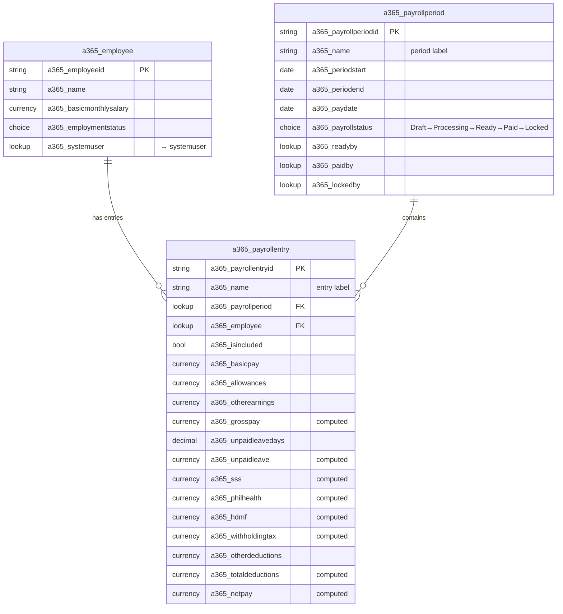

# Phase 4 — Payroll Data Model (Design Spec)

**Project:** The Daily Operation · **Company:** Automations 365
**Milestone:** 1 — Payroll · **Phase:** 4 — Payroll Data Model
**Date:** 2026-09-06 · **Status:** Approved design, pending implementation plan

---

## 1. Goal & scope

Create the Dataverse structure for payroll transactions: the **Payroll Period**
(one semi-monthly cutoff) and the **Payroll Entry** (one employee within one
period), with their relationships to `a365_employee`, the calculated-money
columns, and the workflow status.

**In scope (Phase 4):**

- `a365_payrollperiod` table (dates-only cutoff + status + finalize/paid/lock
  stamps).
- `a365_payrollentry` table (earnings, deductions, computed totals, relationships,
  include flag, calc stamps).
- The `a365_payrollstatus` global choice, simplified to the V1 flow.
- Relationships `a365_payrollperiod_payrollentry` and `a365_employee_payrollentry`.
- Documentation updates: `data-model.md` (tables + ER diagram),
  `naming-conventions.md` (status values), `payroll-task-phases.md` (Phase 7 flow
  correction, Phase 4 checkboxes).

**Out of scope (later phases):**

- The payroll **calculation engine** (gross/statutory/tax/net formulas, rounding,
  effective-dated statutory config tables) — **Phase 5**.
- React `src/features/payroll/` types/services/hooks and any UI — **Phase 6**.
- Status-transition workflow, finalize/lock/mark-paid actions, and
  finalized-payroll immutability enforcement (real-time plug-in) — **Phase 7**.
- Setting `a365_payrollperiod` / `a365_payrollentry` **security-role privileges**
  and the owner-assignment-on-create rule — **Phase 4/6 security step**
  (`security-model.md` §10); this spec creates the tables, not the role grants.
- Audit stamps beyond those listed here — **Phase 9**.

---

## 2. Settled product decisions (V1)

These were confirmed by the product owner during Phase 4 brainstorming and
**override** older wording in `naming-conventions.md`, `payroll-task-phases.md`
(Phase 7), and `CLAUDE.md`:

1. **Fixed semi-monthly cadence for all employees.** Two periods per month: the
   1st–15th, and the 16th–last calendar day (28/29/30/31 as applicable). The
   Payroll Period carries **no configurable frequency** and **no separate cutoff
   date** distinct from the period end. Each period pays **half** of the
   employee's monthly salary, adjusted for absences/unpaid leave, statutory and
   other deductions, allowances, and other earnings.
2. **No payroll approver role.** The **Payroll Admin** prepares, reviews,
   finalizes, and marks payroll paid. No approval queue, no approver permissions.
3. **Simplified status flow:** `Draft → Processing → Ready → Paid → Locked`.
   "Ready" replaces the old *For Review* / *Approved* stages.
4. **Employees are view-only** on their own payroll/payslip and cannot change
   status; transitions are Payroll-Admin-only, enforced at the Dataverse layer.

Modeling decisions confirmed:

5. **Lump-sum variable pay** — allowances, other earnings, other deductions are
   single Currency columns on the entry (no earning/deduction child tables in V1).
6. **Period-level status + per-entry include flag** (`a365_isincluded`) so one
   employee can be held without deleting the row.
7. **Unpaid leave stored as days input + computed amount**
   (`a365_unpaidleavedays` + `a365_unpaidleave`) — clean seam for Milestone 2
   Leave Management, which will later supply the days.
8. **Pay Date kept** on the period as an optional disbursement date.
9. **Period rollup totals are computed on demand**, not stored (avoids
   denormalization/staleness and the field-level-security concern in
   `security-model.md` §4).
10. **Entry primary name** is a composed readable label set by the service, not
    an autonumber.

---

## 3. Global choice — `a365_payrollstatus`

Global option set reused by the Payroll Period (and available to future tables).

| Option | Meaning |
|---|---|
| Draft | Period created; entries being populated/edited. |
| Processing | Calculation running / inputs being finalized. |
| Ready | Admin has reviewed and finalized; ready to pay. |
| Paid | Marked paid; disbursed. |
| Locked | Closed/immutable; corrections only via adjustment process (Phase 7). |

Option integer values follow the publisher option prefix (`74991…`) and **must be
read back from Dataverse** and recorded in `data-model.md` before being encoded in
code (`CLAUDE.md` #5). The transition rules (`Draft → Processing → Ready → Paid →
Locked`) are **not** enforced by this table; centralized transition logic is built
in Phase 7.

---

## 4. Table — `a365_payrollperiod` (Payroll Period)

- **Ownership:** **User or Team owned** (immutable after creation) —
  `security-model.md` §3. A cutoff is managed by the Payroll Admin (optionally an
  `A365 Payroll` owner team, §6).
- **Primary name column:** `a365_name` (Text) — a human-readable period label,
  e.g. `2026-09-01 to 2026-09-15`.
- **Solution:** `A365_DailyOperations`.

### Columns

| Display name | Logical name | Type | Required | Notes |
|---|---|---|---|---|
| Period Label | `a365_name` | Text | Yes | Primary column; format `YYYY-MM-DD to YYYY-MM-DD`. |
| Period Start | `a365_periodstart` | Date only | Yes | 1st or 16th. |
| Period End | `a365_periodend` | Date only | Yes | 15th or last day of month. |
| Pay Date | `a365_paydate` | Date only | No | Disbursement date; distinct from period end. |
| Status | `a365_payrollstatus` | Choice (global `a365_payrollstatus`) | Yes | Default **Draft**. |
| Ready By | `a365_readyby` | Lookup → `systemuser` | No | Stamped on → Ready. |
| Ready On | `a365_readyon` | Date and Time | No | " |
| Paid By | `a365_paidby` | Lookup → `systemuser` | No | Stamped on → Paid. |
| Paid On | `a365_paidon` | Date and Time | No | " |
| Locked By | `a365_lockedby` | Lookup → `systemuser` | No | Stamped on → Locked. |
| Locked On | `a365_lockedon` | Date and Time | No | " |

- **Created/Modified** use standard Dataverse stamps (`createdby`, `createdon`,
  `modifiedby`, `modifiedon`) — not re-created.
- **No stored rollup totals** (total gross/net/headcount) — computed from child
  entries on demand in the Phase 6 dashboard.
- The stamp columns are **written by the Phase 7 transition actions**, not by the
  user directly; they exist now so the schema is stable.

---

## 5. Table — `a365_payrollentry` (Payroll Entry)

- **Ownership:** **User or Team owned** (immutable) — the privacy pivot of
  `security-model.md` §4. In Phase 6 each entry's **owner is assigned to the
  employee's linked `systemuser`** so the Payroll Employee role's User-level Read
  lets an employee see only their own entries.
- **Primary name column:** `a365_name` (Text) — composed label set by the service,
  e.g. `Dela Cruz, Juan — 2026-09-01 to 15`.
- **Solution:** `A365_DailyOperations`.

### Columns

| Group | Display name | Logical name | Type | Required | Notes |
|---|---|---|---|---|---|
| Identity | Entry Label | `a365_name` | Text | Yes | Primary; composed `Employee — Period`. |
| Relationship | Payroll Period | `a365_payrollperiod` | Lookup → `a365_payrollperiod` | Yes | Rel `a365_payrollperiod_payrollentry`. |
| Relationship | Employee | `a365_employee` | Lookup → `a365_employee` | Yes | Rel `a365_employee_payrollentry`. |
| Control | Included | `a365_isincluded` | Yes/No | Yes | Default **Yes**; hold without deleting. |
| Earnings | Basic Pay | `a365_basicpay` | Currency | No | Semi-monthly = ½ monthly salary; salary-basis snapshot. |
| Earnings | Allowances | `a365_allowances` | Currency | No | Lump sum. |
| Earnings | Other Earnings | `a365_otherearnings` | Currency | No | Lump sum. |
| Earnings | Gross Pay | `a365_grosspay` | Currency | No | **Computed** (Phase 5). |
| Deductions | Unpaid Leave Days | `a365_unpaidleavedays` | Decimal | No | Input (days); Leave Mgmt feeds later. |
| Deductions | Unpaid Leave | `a365_unpaidleave` | Currency | No | **Computed** from days × daily rate. |
| Deductions | SSS | `a365_sss` | Currency | No | **Computed**. |
| Deductions | PhilHealth | `a365_philhealth` | Currency | No | **Computed**. |
| Deductions | HDMF / Pag-IBIG | `a365_hdmf` | Currency | No | **Computed**. |
| Deductions | Withholding Tax | `a365_withholdingtax` | Currency | No | **Computed**. |
| Deductions | Other Deductions | `a365_otherdeductions` | Currency | No | Lump sum. |
| Deductions | Total Deductions | `a365_totaldeductions` | Currency | No | **Computed**. |
| Result | Net Pay | `a365_netpay` | Currency | No | **Computed**. |
| Audit | Calculated By | `a365_calculatedby` | Lookup → `systemuser` | No | Set on calculate. |
| Audit | Calculated On | `a365_calculatedon` | Date and Time | No | " |

- **Decimal vs Currency:** money is Currency; `a365_unpaidleavedays` is Decimal
  (fractional days allowed, e.g. `2.0`).
- **"Computed" columns are stored values** written by the Phase 5 calculation
  service — the formulas live in that service, never in the column definition or
  JSX. They are persisted so the payslip and reports read a stable snapshot.
- **One entry per employee per period** is a business rule enforced by the
  load/create logic (Phase 6), not a Dataverse alternate key in V1.

---

## 6. Immutability & snapshot rationale

Finalized payroll is a financial snapshot (`CLAUDE.md` "Payroll Immutability").
The entry's own columns are that snapshot:

- `a365_basicpay` captures the **salary basis** at calculation time, so a later
  change to the employee's `a365_basicmonthlysalary` never rewrites history.
- Phase 5's **effective-dated statutory configuration** captures the **rate
  basis**, so a later rate change never rewrites a historical entry's SSS/PhilHealth/
  HDMF/tax.

Enforcement that a Locked/Paid entry cannot be edited is a **Phase 7** data-layer
control (real-time plug-in per `security-model.md` §8/§12) — this spec makes the
schema ready for it but does not implement it.

---

## 7. Entity-relationship diagram

---

## 8. Relationships

| Schema name | Type | Parent | Child | Behavior |
|---|---|---|---|---|
| `a365_payrollperiod_payrollentry` | 1:N | `a365_payrollperiod` | `a365_payrollentry` | Lookup `a365_payrollperiod` on entry, required. |
| `a365_employee_payrollentry` | 1:N | `a365_employee` | `a365_payrollentry` | Lookup `a365_employee` on entry, required. |

Cascade behavior favors **Restrict Delete** on both parents — payroll records are
not deleted to fix mistakes (`security-model.md` §7); the exact cascade
configuration is confirmed at creation and recorded in `data-model.md`.

---

## 9. Creation mechanics & verification

Per project convention, Dataverse authoring goes through the Microsoft
`dataverse` plugin (`dv-metadata` / Web API path), not the maker portal or `pac`:

1. Create the `a365_payrollstatus` global choice (Draft, Processing, Ready, Paid,
   Locked).
2. Create `a365_payrollperiod` (User/Team owned) and its columns.
3. Create `a365_payrollentry` (User/Team owned) and its columns.
4. Create the two 1:N relationships/lookups.
5. Add all components to the `A365_DailyOperations` solution; export + unpack into
   `solution/A365_DailyOperations/src` and commit.
6. **Verify every logical name, entity-set name, choice integer value, and
   relationship name in Dataverse** and record the confirmed schema in
   `docs/data-model.md` before any code in later phases references them
   (`CLAUDE.md` #5, `naming-conventions.md`). Ownership type is **immutable**, so
   confirm User/Team owned at creation.

---

## 10. Documentation updates (part of this phase)

- **`docs/data-model.md`** — replace the "Phase 4 — Payroll tables (to be
  designed)" stub with the confirmed `a365_payrollperiod` and `a365_payrollentry`
  schemas (post-verification logical names + choice values) and the ER diagram.
- **`docs/naming-conventions.md`** — change the `a365_payrollstatus` option list
  from `Draft, Processing, For Review, Approved, Paid, Locked` to
  `Draft, Processing, Ready, Paid, Locked`.
- **`docs/payroll-task-phases.md`** — Phase 7: replace the
  `Draft → Processing → For Review → Approved → Paid → Locked` flow and the
  "Payroll Approver review screen / Approve Payroll / approver" tasks with the
  `Draft → Processing → Ready → Paid → Locked` flow and Admin-only finalize; check
  off the Phase 4 tasks as they land.
- **`CLAUDE.md`** carries the old six-status flow and approval wording in the
  Payroll Period / Payroll Domain sections. Because `CLAUDE.md` is the product
  owner's instruction file (and already has unrelated uncommitted edits), flag the
  discrepancy for the owner rather than editing it unprompted.

---

## 11. Testing considerations (executed later)

Phase 4 delivers schema, not behavior, so its "tests" are verification-oriented;
functional tests land with the phases that add logic:

- **Now (schema verification):** tables/columns/choice/relationships exist with
  the intended logical names, ownership is User/Team owned, choice integers
  recorded, solution export committed.
- **Phase 5:** calculation unit tests populate the computed columns.
- **Phase 12:** the security test plan (`security-model.md` §11) verifies an
  employee can read only their own `a365_payrollentry` by direct request, cannot
  write/delete any payroll record, and cannot transition status — the record-level
  behavior this ownership model exists to guarantee.

---

## 12. Acceptance criteria for Phase 4

- [ ] `a365_payrollstatus` global choice exists with exactly the five V1 options.
- [ ] `a365_payrollperiod` exists (User/Team owned) with the §4 columns.
- [ ] `a365_payrollentry` exists (User/Team owned) with the §5 columns.
- [ ] Both relationships exist with the §8 schema names and required lookups.
- [ ] All components are in `A365_DailyOperations`; solution unpacked + committed.
- [ ] Confirmed logical names + choice integers recorded in `docs/data-model.md`.
- [ ] `naming-conventions.md` and `payroll-task-phases.md` updated per §10.
